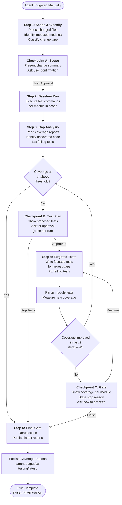
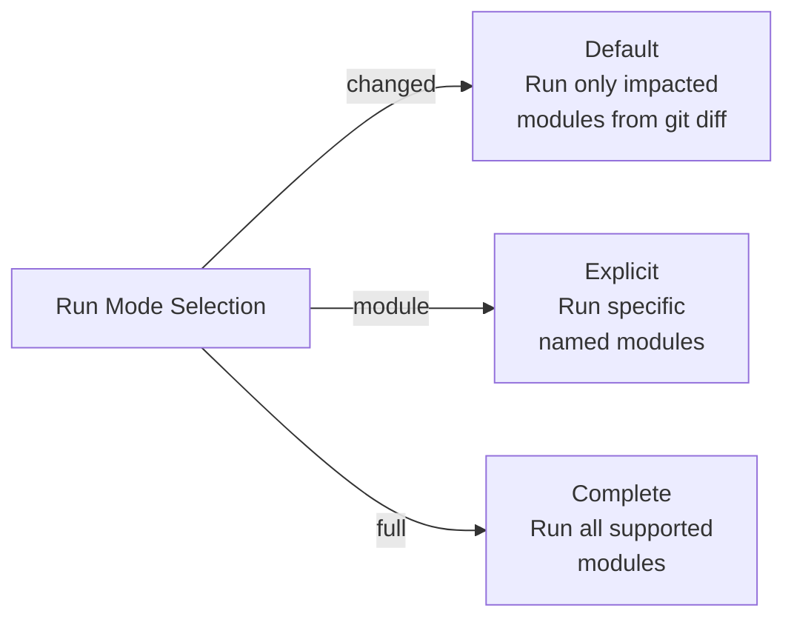
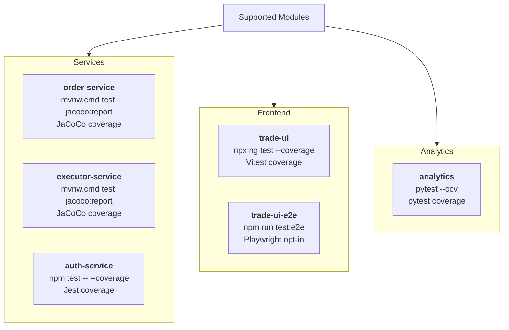
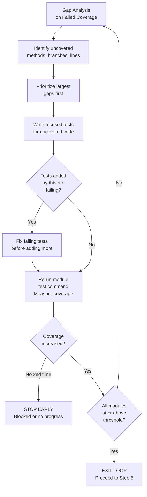
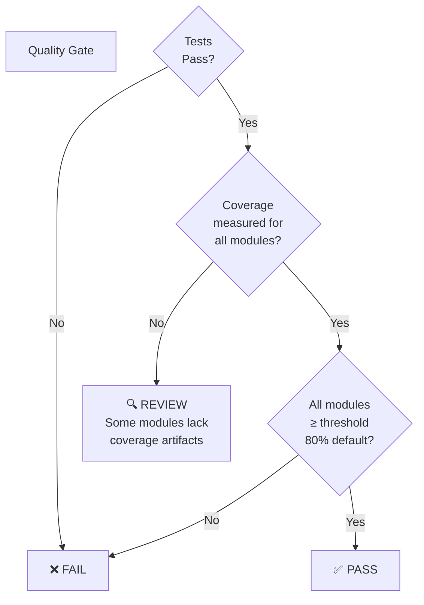

# GitHub Agents

This directory contains custom VS Code agents that enhance the development workflow for the Artha trading system.

## Available Agents

### QA-Testing Agent

**Purpose:** Ensure every meaningful code change gets efficient testing with a safety gate based on code coverage.

**Trigger:** Manual invocation only (never auto-runs).

**Key Features:**
- Change-based testing detection
- Coverage threshold enforcement (default: 80%)
- Iterative test generation until coverage targets are met
- Focused testing on impacted modules only
- Human checkpoints at critical decision points

---

## QA-Testing Agent Workflow

### 5-Step Fixed Run Path



### Run Modes



### Supported Modules & Commands



### Coverage Loop (Steps 3-4 Iteration)



### Human Checkpoints

#### Checkpoint A: Scope Confirmation
```
Input:
- List of changed files
- Impacted modules detected
- Change classification (code vs config)

Output Options:
1. Proceed with proposed scope
2. Expand scope to full workspace  
3. Provide custom scope
```

#### Checkpoint B: Test Plan Approval
```
Input:
- Proposed test files to create/modify
- Notification that loop will iterate until threshold

Output Options:
1. Approve and iterate until threshold met
2. Revise the test plan
3. Skip test generation (keep current results)

Note: Approval covers all iterations; not asked again between iterations
```

#### Checkpoint C: Gate Outcome (Early Stop Only)
```
Input (only if coverage threshold not met):
- Coverage per module
- Iteration history
- Reason for early stop (no progress, blocked, or user interrupt)

Output Options:
1. Resume loop with revised approach
2. Finish run and keep current result
3. Stop and return diagnostics only

Note: Skipped entirely if threshold is met; goes straight to Step 5
```

---

## Coverage Gate Decision Logic



---

## End-of-Run Output

All runs produce standardized output:

### Coverage Reports (Per Module)
- **order-service:** `services/order-service/target/site/jacoco/index.html`
- **executor-service:** `services/executor-service/target/site/jacoco/index.html`
- **auth-service:** `services/auth-service/coverage/coverage-summary.json`
- **trade-ui:** `frontend/trade-ui/coverage/` (Vitest summary)
- **analytics:** `databases/duckdb/analytics/coverage.xml`

### Agent Output
- **Report JSON:** `.agent-output/qa-testing/latest/report.json`
- **Report HTML:** `.agent-output/qa-testing/latest/report.html`

### Summary Information
- Scope and changed files
- Commands executed per module
- Coverage before/after each iteration
- Final gate status: PASS / REVIEW / FAIL
- Next recommended step

---

## Run Examples

### Default: Test Changed Modules
```
Agent scope: changed
Affected modules: order-service, trade-ui (detected from git diff)
Threshold: 80% (default)
```

### Explicit Module
```
Agent scope: module
Named module: order-service
Threshold: 75% (custom)
```

### Full Workspace
```
Agent scope: full
All modules: order-service, executor-service, auth-service, trade-ui, analytics
Threshold: 80% (default)
```

---

## Design Principles

1. **Manual Trigger Only:** Agent never auto-runs; prevents CI/CD interference.
2. **Fixed 5-Step Path:** Consistent flow across all invocations.
3. **Iterative Coverage Loop:** Repeats until threshold is met, not just once.
4. **Human Checkpoints:** Three decision gates keep the user in control.
5. **Change-Focused:** Default scope targets only impacted modules.
6. **Script-Free:** Direct command execution; no complex orchestration scripts.
7. **One Output:** Latest report replaces previous; no timestamped folders.

---

## Configuration Files

- **Agent Definition:** [qa-testing.agent.md](agents/qa-testing.agent.md)
- **Instructions & Standards:** [qa-testing.instructions.md](instructions/qa-testing.instructions.md)

