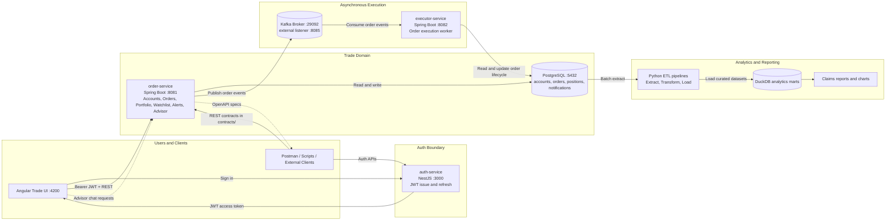

# Full System Architecture and Flow Diagram

This document describes the end-to-end architecture and runtime flow of the Artha trading platform across UI, APIs, asynchronous execution, and analytics.

## System Topology

## Primary Runtime Flows

1. Authentication
- User signs in through the UI.
- auth-service verifies credentials and returns JWT tokens.
- UI uses the token for protected trade endpoints.

2. Order Placement and Execution
- UI submits an order to order-service.
- order-service validates account, symbol, quantity, and price.
- Order is persisted to PostgreSQL and published to Kafka.
- executor-service consumes event, executes order logic, and updates final status.

3. Analytics Pipeline
- ETL extracts historical trading/account data from PostgreSQL.
- ETL transforms and loads curated datasets into DuckDB marts.
- Reports and charts are generated from DuckDB outputs.

## Ownership Boundaries

- auth-service owns identity and token issuance.
- order-service owns trade-domain APIs and persistence rules.
- executor-service owns asynchronous execution logic.
- ETL owns analytical transformations and reporting artifacts.

## API Contract Sources

OpenAPI contracts are located in contracts/:
- auth-api.yaml
- trade-api.yaml
- portfolio-api.yaml
- watchlists-api.yaml
- strategies-api.yaml
- notifications-api.yaml
- advisor-api.yaml
