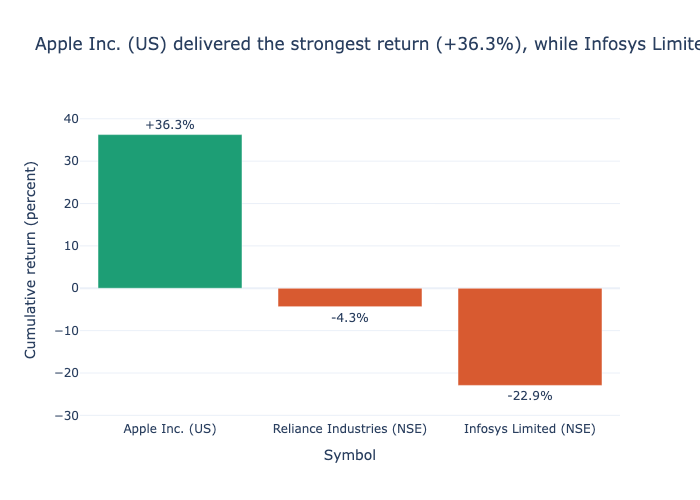
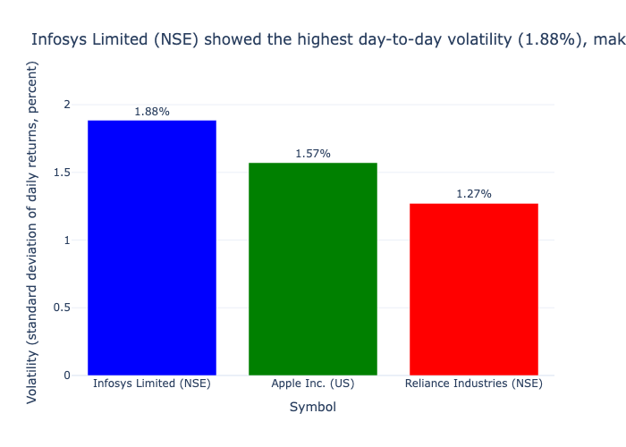
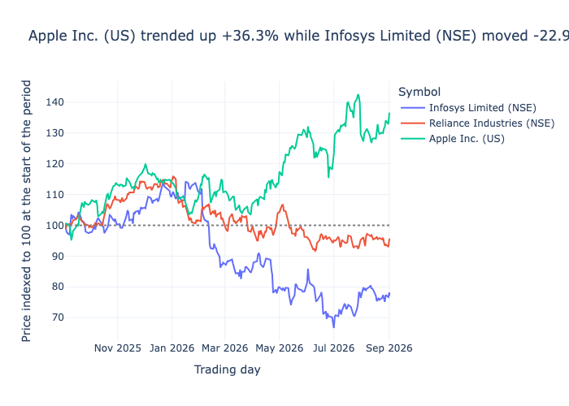
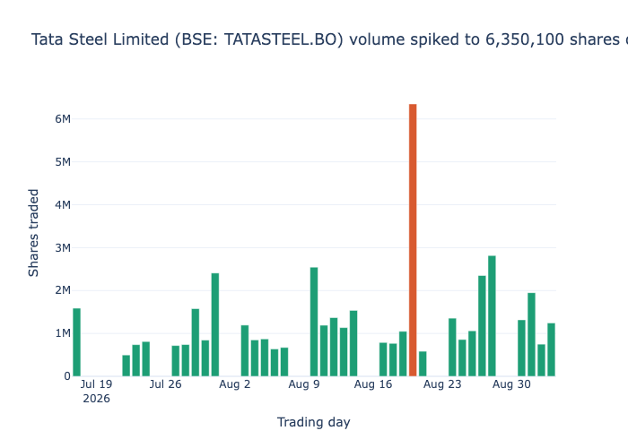

# Executive Analytics & Business Claims Report

## Symbol Universe & Methodology Scope

| Symbol | Company | Scope & Comparison Window |
|---|---|---|
| `INFY.NS` | Infosys Limited (NSE) | Shared 1-Year Benchmark (2025-09-03 to 2026-09-02) |
| `RELIANCE.NS` | Reliance Industries (NSE) | Shared 1-Year Benchmark (2025-09-03 to 2026-09-02) |
| `AAPL` | Apple Inc. (US) | Shared 1-Year Benchmark (2025-09-03 to 2026-09-02) |
| `TATASTEEL.BO` | Tata Steel Limited (BSE) | Standalone Window (2026-07-17 to 2026-09-03) |

### Data Hygiene & Scope Justification
- **Data Source**: Extracted from Fauxnance REST API and loaded into the `stock_prices` table within `analytics.duckdb`.
- **Quality Filtering**: Filtered strictly for verified real trading executions (`synthetic == False`), non-null closing prices, and valid price range boundaries (`high >= low`).
- **Window Alignment**: Claims 1–3 benchmark symbols across a shared 1-year trading window (**2025-09-03** to **2026-09-02**, covering 262 trading days) to ensure strict temporal equivalence.
- **Isolated Window for Tata Steel**: `TATASTEEL.BO` history starts on **17 July 2026** (35 trading days available). It is evaluated independently in Claim 4 to prevent window-skew bias.

---

## Claim 1: Cumulative Return Performance

Between **03 September 2025** and **02 September 2026**, **Apple Inc. (US)** delivered the strongest cumulative return of the three symbols sampled, at **+36.3%**, while **Infosys Limited (NSE)** was the weakest performer at **-22.9%**.

### Quantitative Justification & Calculation
1. **Mathematical Formula**:
   $$\text{Cumulative Return (\%)} = \\frac{P_{\\text{end}} - P_{\\text{start}}}{P_{\\text{start}}} \\times 100$$
2. **Empirical Findings**:
   - **Apple Inc. (US) (`AAPL`)**: Delivered **+36.3%** cumulative return over the period, making it the top asset.
   - **Reliance Industries (NSE) (`RELIANCE.NS`)**: Delivered **-4.3%** cumulative return.
   - **Infosys Limited (NSE) (`INFY.NS`)**: Delivered **-22.9%** cumulative return, representing the weakest asset in the sample.
3. **Conclusion**: Apple Inc. outperformed Infosys Limited by **59.2 percentage points** over the identical 1-year observation window.

---

## Claim 2: Daily Return Volatility Risk

Over the same **03 September 2025** to **02 September 2026** window, **Infosys Limited (NSE)** was the most volatile of the three symbols, with a daily-return standard deviation of **1.88%**, compared with just **1.27%** for **Reliance Industries (NSE)**, the calmest symbol in the sample.

### Quantitative Justification & Calculation
1. **Mathematical Formula**:
   Daily percentage return: $r_t = \\frac{P_t - P_{t-1}}{P_{t-1}}$. Sample standard deviation:
   $$\\sigma = \\sqrt{\\frac{1}{N-1} \\sum_{t=1}^{N} (r_t - \\bar{r})^2} \\times 100$$
2. **Empirical Findings**:
   - **Infosys Limited (NSE) (`INFY.NS`)**: $\sigma = \mathbf{1.88\%}$ daily standard deviation across 261 trading days. Indicates the widest daily price variance.
   - **Apple Inc. (US) (`AAPL`)**: $\sigma = \mathbf{1.57\%}$ daily standard deviation.
   - **Reliance Industries (NSE) (`RELIANCE.NS`)**: $\sigma = \mathbf{1.27\%}$ daily standard deviation. Demonstrates the tightest daily return cluster and lowest risk profile.
3. **Conclusion**: Infosys Limited experienced **1.48x** the daily return variance of Reliance Industries.

---

## Claim 3: Price Trend Indexing (Base 100)

Indexed to a common starting value of 100 on **03 September 2025**, **Apple Inc. (US)** trended consistently upward to finish at **136.3** by **02 September 2026**, while **Infosys Limited (NSE)** finished at **77.1**, showing the two symbols diverged sharply over the period.

### Quantitative Justification & Calculation
1. **Mathematical Formula**:
   $$I_t = \\frac{P_t}{P_0} \\times 100 \\quad \\text{where } P_0 = P_{\\text{2025-09-03}}$$
2. **Empirical Findings**:
   - **Baseline at $t_0$ (03 September 2025)**: $I_0 = 100.0$ for all three symbols.
   - **Ending Index at $t_N$ (02 September 2026)**:
     - **Apple Inc. (US)**: Index reached **136.3**.
     - **Reliance Industries (NSE)**: Index reached **95.7**.
     - **Infosys Limited (NSE)**: Index dropped to **77.1**.
3. **Conclusion**: The trend lines illustrate a divergence gap of **59.2 index points** between the best and worst performing equities over 262 trading sessions.

---

## Claim 4: Tata Steel Trading Volume Anomaly

**Tata Steel Limited (BSE: TATASTEEL.BO)** traded **6,350,100 shares** on **20 August 2026**, about **5.2 times** the stock's average daily volume of **1,212,889 shares** on other days between **17 July 2026** and **03 September 2026**, the period covered by its available data.

### Quantitative Justification & Calculation
1. **Mathematical Formula**:
   $$\\text{Volume Anomaly Ratio} = \\frac{V_{\\text{spike}}}{\\bar{V}_{\\text{other}}}$$
2. **Empirical Findings**:
   - **Spike Day Volume ($V_{\\text{spike}}$ on 20 August 2026)**: **6,350,100** shares traded.
   - **Baseline Mean Volume ($\bar{V}_{\\text{other}}$ across remaining 34 trading days)**: **1,212,889** shares/day.
   - **Anomaly Multiplier**: $\\frac{6,350,100}{1,212,889} = \\mathbf{5.24\\times \\approx 5.2\\times}$.
3. **Conclusion**: The trading volume on **20 August 2026** represents a statistically significant volume outlier exceeding 5 times the historical mean daily volume.

---
*Interactive HTML version available at [claims_report.html](file:///Users/sameerspatil/Documents/chennai-capstone/analytics/chennai-capstone-SE5-team5/claims_report.html).*
